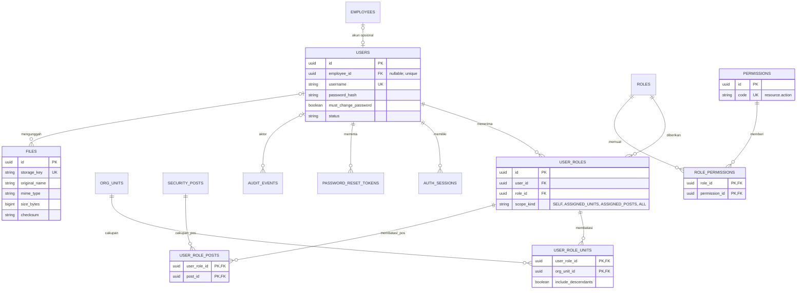
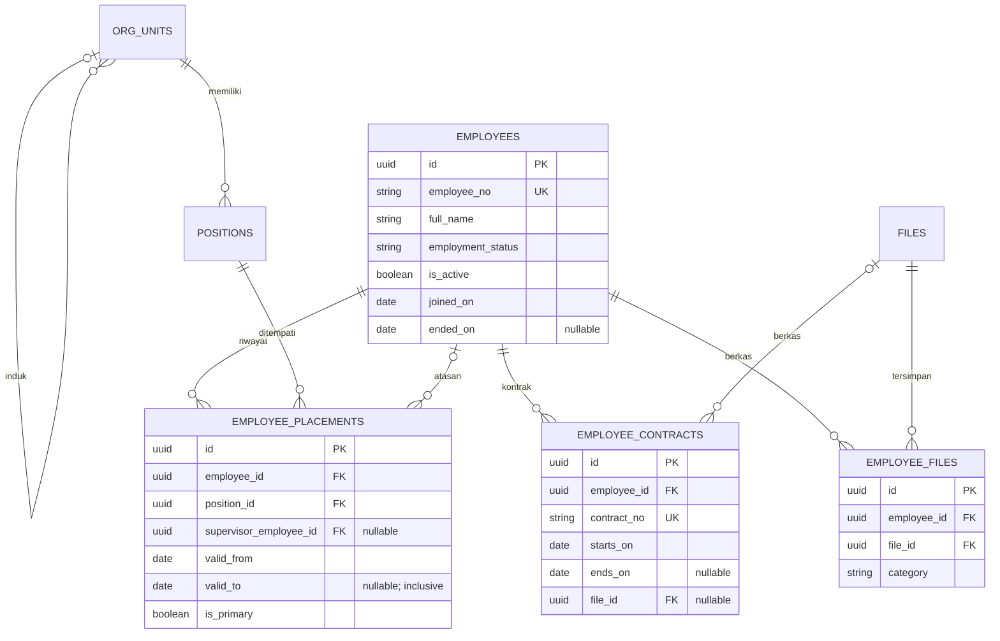
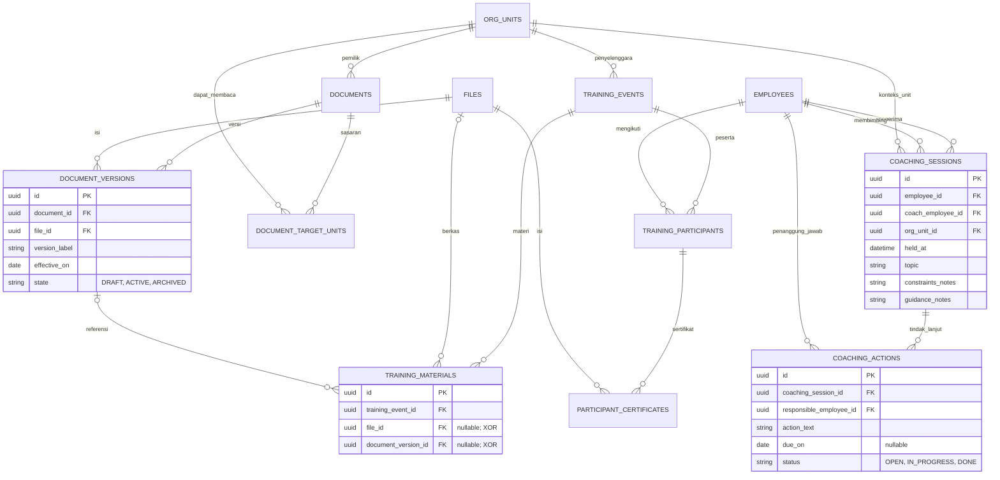
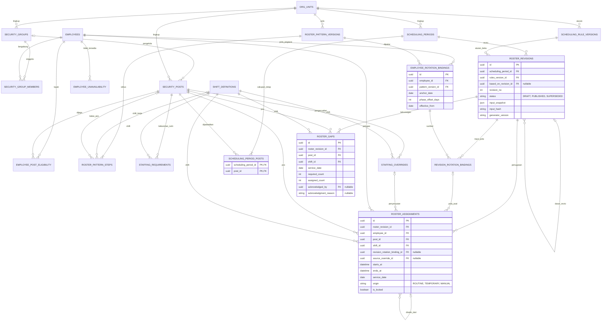
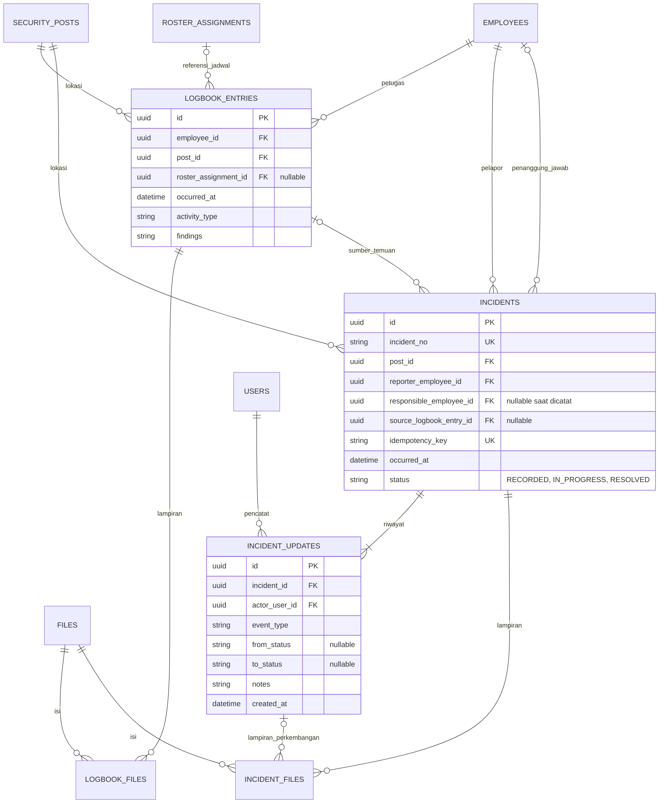

# ERD logis — Login & Hak Akses, SDM, dan Keamanan BP Besakih

Versi 1.0 · 15 Oktober 2026 · Rancangan MVP untuk dibahas dan diimplementasikan bersama PRD.

Dokumen ini menjelaskan model data logis, relasi, dan aturan integritas. Ini bukan skema SQL dan belum mengikat produk pada penyedia basis data tertentu. Identitas pejabat, jumlah petugas, jam shift, hari kerja, dan batas istirahat tidak ditetapkan oleh ERD; semuanya harus diisi dari kebijakan operasional yang dikonfirmasi BP Besakih.

## 1. Batas rancangan

Tiga bagian produk menggunakan sumber data bersama: Login & Hak Akses; SDM; Keamanan. Dashboard adalah hasil pembacaan data yang telah diotorisasi, sehingga tidak memerlukan tabel dashboard tersendiri.

MVP SDM memuat data pegawai/organisasi, regulasi/SOP, pelatihan/standar layanan, dan coaching. Evaluasi & Penilaian hanya mencatat coaching serta tindak lanjut. MVP Keamanan memuat jadwal, logbook/patroli, laporan kejadian, dan tampilan SOP. Penjadwalan mendukung pola rutin otomatis, penyesuaian sementara bertanggal, lalu kembali ke fase rotasi rutin asli.

Tidak ada tabel untuk pengajuan/approval cuti dan izin, saldo cuti, payroll/benefit, KPI, rincian pekerjaan, skor evaluasi, kalender upacara, GPS, QR patroli, atau absensi otomatis. `employee_unavailability` adalah catatan ketersediaan operasional oleh koordinator, bukan pengajuan atau persetujuan cuti/izin.

Terdapat **49 entitas logis**, termasuk tabel penghubung, lampiran, autentikasi, dan versi jadwal. Jumlah ini tidak menunjukkan jumlah layar: tabel penghubung dikelola dari layar induknya. Normalisasi diperlukan agar dokumen, data pegawai, dan sejarah jadwal tidak disalin menjadi sumber data yang saling berbeda.

## 2. Konvensi dan integritas umum

- Nama entitas menggunakan `snake_case`; judul diagram menggunakan nama yang sama dalam huruf besar.
- Kecuali dinyatakan PK komposit, setiap entitas mempunyai `id:ID` sebagai PK. Semua entitas mempunyai `created_at:TS`. `created_by:ID? → users.id` dipakai untuk catatan bisnis yang dibuat pengguna; boleh kosong hanya untuk proses sistem/import awal yang tetap dicatat pada audit. Catatan yang dapat diedit mempunyai `updated_at:TS` dan `row_version:I` untuk mendeteksi perubahan bersamaan. Tabel penghubung, token, sesi, dan audit tidak wajib memiliki `created_by`.
- Tipe: `ID` = identitas UUID abstrak; `T` = teks; `I` = bilangan bulat; `B` = boolean; `D` = tanggal lokal; `TS` = waktu absolut; `TIME` = jam lokal; `J` = snapshot terstruktur. Tanda `?` berarti boleh kosong. Semua kolom dalam bagian **wajib** tidak boleh kosong.
- FK selalu menunjuk baris yang ada. Penghapusan fisik data yang sudah dirujuk ditolak; gunakan status nonaktif/arsip. Pemusnahan data berdasarkan kebijakan retensi merupakan pekerjaan terpisah yang harus mempertimbangkan seluruh relasi.
- Semua rentang tanggal `valid_from/valid_to` atau `starts_on/ends_on` menggunakan akhir inklusif. Rentang waktu `starts_at/ends_at` adalah `[mulai, selesai)` sehingga satu penugasan boleh tepat berakhir saat interval berikutnya dimulai hanya bila aturan jeda juga terpenuhi.
- Tanggal operasional dan `service_date` menggunakan **WITA, Asia/Makassar (UTC+08:00)**. Waktu kejadian, audit, login, dan penugasan dapat disimpan sebagai UTC, lalu ditampilkan dalam WITA. `service_date` selalu tanggal lokal mulai shift, meskipun shift berakhir keesokan hari.
- Nilai status pada dokumen ini adalah kode sistem; antarmuka memakai label Bahasa Indonesia.
- Kode/username unik dinormalisasi sebelum dibandingkan. Teks wajib tidak boleh hanya spasi. FK nullable tidak berarti dapat diisi dengan ID yang tidak ada.
- Semua perubahan bisnis penting, perubahan hak akses, unduhan data terbatas, reset akun, publikasi jadwal, dan perubahan status kejadian menghasilkan `audit_events`. Password, token mentah, dan isi berkas sensitif tidak dimasukkan ke audit.

## 3. Kamus data — Login, hak akses, dan berkas bersama

| Entitas | Kolom wajib selain kolom umum | Kolom nullable | PK, unique, dan aturan utama |
|---|---|---|---|
| `users` | `username:T`, `password_hash:T`, `status:T`, `must_change_password:B`, `failed_login_count:I`, `password_changed_at:TS` | `employee_id:ID → employees`, `locked_until:TS`, `last_login_at:TS` | PK `id`; unique username dan employee_id bila terisi. Status `ACTIVE/INACTIVE/LOCKED`. Pegawai dapat belum punya akun; akun administrasi dapat tidak terikat pegawai. Tidak ada pendaftaran publik. Usulan DEC-12 pada PRD: pegawai nonaktif yang terikat akun ditolak pada permintaan berikutnya, termasuk sesi yang sudah terbuka. |
| `roles` | `code:T`, `name:T`, `is_system:B`, `is_active:B` | `description:T` | Unique code. Role akses terpisah dari jabatan organisasi. Role Super Admin dilindungi; tidak boleh menghapus/mematikan seluruh Super Admin aktif. |
| `permissions` | `code:T`, `module_code:T`, `resource:T`, `action:T` | `description:T` | Unique code, misalnya `security.roster.publish`. Daftar permission ditetapkan aplikasi; Super Admin menyusun role dari daftar tersebut. |
| `user_roles` | `user_id:ID → users`, `role_id:ID → roles`, `scope_kind:T` | — | Unique `(user_id, role_id, scope_kind)`. Scope `SELF/ASSIGNED_UNITS/ASSIGNED_POSTS/ALL`. Tidak ada grant implisit karena jabatan. |
| `user_role_units` | `user_role_id:ID → user_roles`, `org_unit_id:ID → org_units`, `include_descendants:B` | — | PK komposit `(user_role_id, org_unit_id)`. Hanya boleh ada jika scope `ASSIGNED_UNITS`; scope tersebut wajib memiliki ≥1 unit. Hierarki turunan hanya ikut bila include_descendants true. |
| `user_role_posts` | `user_role_id:ID → user_roles`, `post_id:ID → security_posts` | — | PK komposit `(user_role_id, post_id)`. Hanya boleh ada jika scope `ASSIGNED_POSTS`; scope tersebut wajib memiliki ≥1 pos. Hanya berlaku pada sumber daya Keamanan yang dipetakan ke pos; sumber daya tanpa pemetaan pos ditolak. |
| `role_permissions` | `role_id:ID → roles`, `permission_id:ID → permissions` | — | PK komposit `(role_id, permission_id)`. Model hanya grant; default tidak boleh. |
| `auth_sessions` | `user_id:ID → users`, `token_hash:T`, `expires_at:TS`, `last_seen_at:TS` | `revoked_at:TS`, `ip_address:T`, `user_agent:T` | Unique token_hash; expiry > created_at. Jangan menyimpan bearer token mentah. Akun nonaktif, reset password, dan perubahan keamanan yang relevan membatalkan sesi. |
| `password_reset_tokens` | `user_id:ID → users`, `token_hash:T`, `expires_at:TS`, `issued_by:ID → users` | `consumed_at:TS`, `revoked_at:TS` | Unique token_hash; expiry > created_at; sekali pakai, berumur pendek menurut konfigurasi keamanan. Penerbit harus mempunyai izin reset. Reset dibantu admin; tidak membutuhkan integrasi email/WhatsApp. |
| `audit_events` | `action:T`, `object_type:T`, `object_key:T`, `occurred_at:TS`, `outcome:T`, `request_id:T` | `actor_user_id:ID → users`, `reason:T`, `change_summary:J`, `ip_address:T` | Append-only. Actor kosong hanya sistem. Referensi object_type/object_key diizinkan di audit sebagai identitas peristiwa historis; tidak menjadi relasi bisnis atau izin unduh. |
| `files` | `storage_key:T`, `original_name:T`, `mime_type:T`, `size_bytes:I`, `checksum:T`, `status:T` | `uploaded_by:ID → users` | Unique storage_key; size_bytes >0. Status `AVAILABLE/QUARANTINED/ARCHIVED`. Berkas karantina tidak dapat digunakan/diunduh. storage_key bukan URL publik dan tidak memberikan izin. Isi berkas yang dirujuk versi terbit tidak ditimpa. |

**Evaluasi akses:** untuk setiap baris `user_roles`, pasangan role-permission dievaluasi bersama scope baris itu. Hasil akses merupakan gabungan grant yang cocok. Grant melihat seluruh pegawai tidak memperluas grant mengubah pegawai yang semula hanya berlaku untuk unit tertentu. `SELF` memerlukan hubungan users.employee_id dan berlaku hanya untuk sumber daya yang memang mendukung akses diri.

`ASSIGNED_POSTS` dapat membatasi koordinator pada pos tertentu walaupun pos-pos itu berada dalam unit organisasi yang sama. Grant pos tidak memberikan hak mengelola master kelompok/pegawai lintas unit. Pengelolaan master grup memerlukan permission dan scope unit/ALL tersendiri. Daftar pilihan petugas dan nama pada pencarian hanya menampilkan informasi minimum yang diperlukan sesuai izin penugasan; hak menyusun jadwal tidak membuka seluruh profil atau berkas pegawai.

Keanggotaan unit bukan izin membaca semua catatan coaching. Coaching memerlukan permission terkait dan hubungan sebagai pegawai yang dibina, coach yang ditunjuk, atau pengelola coaching dengan cakupan unit yang sah. Catatan kasus keamanan, berkas pegawai, dan unduhan mengikuti otorisasi induknya di sisi server. Tidak boleh ada endpoint berkas yang lolos hanya karena pengguna mengetahui `file_id`.

## 4. Kamus data — Pegawai dan organisasi

| Entitas | Kolom wajib selain kolom umum | Kolom nullable | PK, unique, dan aturan utama |
|---|---|---|---|
| `org_units` | `code:T`, `name:T`, `is_active:B` | `parent_id:ID → org_units` | Unique code. Satu induk maksimum; tidak boleh menunjuk diri atau membentuk siklus. Unit mencakup struktur aktual BP Besakih, tidak diturunkan dari role aplikasi. |
| `positions` | `org_unit_id:ID → org_units`, `code:T`, `name:T`, `is_active:B` | — | Unique code. Posisi dapat memiliki banyak pegawai. org_unit_id immutable setelah posisi dirujuk; perubahan unit akibat reorganisasi membuat posisi baru dan penempatan baru. Tidak mempunyai kolom KPI atau rincian pekerjaan pada MVP. |
| `employees` | `employee_no:T`, `full_name:T`, `employment_status:T`, `is_active:B`, `joined_on:D` | `ended_on:D`, `phone:T`, `email:T` | Unique employee_no. ended_on ≥ joined_on bila terisi. employment_status mencatat jenis/status kepegawaian; is_active menentukan status aktif operasional secara terpisah. Daftar status mengikuti data/ketentuan BP Besakih. Nomor telepon/email tidak harus menjadi akun login. |
| `employee_placements` | `employee_id:ID → employees`, `position_id:ID → positions`, `valid_from:D`, `is_primary:B` | `supervisor_employee_id:ID → employees`, `valid_to:D` | valid_to ≥ valid_from. Interval penempatan utama per pegawai tidak tumpang tindih; satu penempatan utama aktif untuk pegawai aktif yang sudah ditugaskan. Atasan bukan diri sendiri; rantai atasan aktif tidak membentuk siklus. Unit diperoleh dari positions. |
| `employee_contracts` | `employee_id:ID → employees`, `contract_no:T`, `starts_on:D` | `ends_on:D`, `file_id:ID → files`, `notes:T` | Unique contract_no; ends_on ≥ starts_on. Tidak wajib ada untuk semua status pegawai. Berkas kontrak harus tunduk pada izin berkas pegawai. Kontrak tidak menghasilkan perhitungan payroll/hak cuti. |
| `employee_files` | `employee_id:ID → employees`, `file_id:ID → files`, `category:T`, `title:T` | `notes:T` | Unique `(employee_id, file_id)`. Referensi langsung dua FK; tidak menggunakan owner_type/owner_id. |

Perubahan jabatan/atasan dicatat dengan menutup interval penempatan lama dan membuat interval baru dalam satu transaksi, bukan menghapus riwayat. Data unit saat coaching atau kejadian dicatat disimpan sebagai konteks pada transaksi tersebut; pemindahan pegawai tidak memindahkan konteks historis secara diam-diam. org_unit_id pada posisi dan pos keamanan yang sudah dirujuk tidak boleh dipindahkan untuk melakukan reorganisasi: buat master baru, nonaktifkan master lama bila sesuai, lalu buat penempatan atau penugasan baru. Riwayat dan otorisasi unit pada catatan lama tetap mengacu pada konteks aslinya.

## 5. Kamus data — Dokumen, pelatihan, dan coaching

| Entitas | Kolom wajib selain kolom umum | Kolom nullable | PK, unique, dan aturan utama |
|---|---|---|---|
| `documents` | `document_code:T`, `title:T`, `category:T`, `owner_org_unit_id:ID → org_units`, `audience_kind:T`, `is_archived:B` | `description:T` | Unique document_code. Category dapat berupa regulasi/SOP/standar layanan. Audience `ALL_UNITS/SELECTED_UNITS`. Tidak perlu membuat salinan dokumen untuk modul Keamanan. |
| `document_versions` | `document_id:ID → documents`, `file_id:ID → files`, `version_label:T`, `effective_on:D`, `state:T` | `change_notes:T`, `activated_by:ID → users`, `activated_at:TS`, `archived_at:TS` | Unique `(document_id, version_label)`. Status `DRAFT/ACTIVE/ARCHIVED`; maksimum satu ACTIVE per dokumen. DRAFT boleh diperbarui. Aktivasi eksplisit oleh pengguna berizin hanya jika effective_on ≤ tanggal lokal hari ini; versi lama diarsipkan atomik. ACTIVE/ARCHIVED wajib activated_by/at; ARCHIVED wajib archived_at. Isi/file/nomor versi yang pernah aktif immutable; koreksi menjadi versi baru. Tidak ada aktivasi otomatis berdasarkan tanggal. |
| `document_target_units` | `document_id:ID → documents`, `org_unit_id:ID → org_units` | — | PK komposit `(document_id, org_unit_id)`. Wajib ≥1 sasaran jika SELECTED_UNITS; tidak dipakai jika ALL_UNITS. Unit pengelola tetap memerlukan permission kelola. |
| `training_events` | `title:T`, `topic:T`, `organizer_org_unit_id:ID → org_units`, `starts_at:TS`, `ends_at:TS`, `status:T` | `organizer_name:T`, `location:T`, `description:T` | ends_at > starts_at; status `PLANNED/COMPLETED/CANCELLED`. Tanggal boleh lintas hari. organizer_org_unit_id adalah pemilik pencatatan internal; organizer_name dapat mencatat penyelenggara eksternal. |
| `training_participants` | `training_event_id:ID → training_events`, `employee_id:ID → employees`, `attendance_status:T` | `attendance_notes:T`, `attendance_recorded_by:ID → users`, `attendance_recorded_at:TS` | Unique `(training_event_id, employee_id)`. Kehadiran manual `NOT_RECORDED/PRESENT/ABSENT`; bukan integrasi mesin absensi. Pencatat dan waktu wajib bila kehadiran sudah dicatat. |
| `training_materials` | `training_event_id:ID → training_events`, `title:T` | `file_id:ID → files`, `document_version_id:ID → document_versions` | **Tepat satu** dari file_id atau document_version_id harus terisi. Materi unggahan memakai FK file; materi SOP/standar layanan menunjuk versi dokumen tertentu. Bukan referensi polimorfik bebas. |
| `participant_certificates` | `training_participant_id:ID → training_participants`, `file_id:ID → files` | `certificate_no:T`, `issued_on:D` | Unique `(training_participant_id, file_id)`. Sertifikat melekat pada peserta, sehingga riwayat per pegawai dapat ditelusuri. |
| `coaching_sessions` | `employee_id:ID → employees`, `coach_employee_id:ID → employees`, `org_unit_id:ID → org_units`, `held_at:TS`, `topic:T`, `guidance_notes:T` | `constraints_notes:T`, `agreement_notes:T` | Coach berbeda dari pegawai yang dibina. org_unit_id adalah konteks unit saat coaching; tidak berubah otomatis ketika pegawai pindah. Tidak ada nilai/skor/KPI. |
| `coaching_actions` | `coaching_session_id:ID → coaching_sessions`, `responsible_employee_id:ID → employees`, `action_text:T`, `status:T` | `due_on:D`, `progress_notes:T`, `completion_notes:T`, `completed_at:TS` | Status `OPEN/IN_PROGRESS/DONE`. completed_at dan completion_notes wajib jika DONE; completed_at kosong untuk status lain. Penanggung jawab tidak otomatis berhak melihat seluruh sesi coaching; akses mengikuti kebijakan sumber daya tersebut. |

Daftar SOP Keamanan memfilter dokumen kategori relevan yang dapat diakses. Tampilan standar layanan juga mengambil dokumen yang sama. Hubungan materi ke document_versions mempertahankan bukti versi yang digunakan saat pelatihan, meskipun versi aktif dokumen kemudian berganti.

## 6. Kamus data — Master Keamanan dan ketersediaan

| Entitas | Kolom wajib selain kolom umum | Kolom nullable | PK, unique, dan aturan utama |
|---|---|---|---|
| `security_groups` | `org_unit_id:ID → org_units`, `code:T`, `name:T`, `is_active:B` | — | Unique code. Kelompok operasional dapat mencerminkan koordinator wilayah, Linmas, dan Bankamda. Angka wilayah merupakan data konfigurasi, bukan role akses. |
| `security_group_members` | `security_group_id:ID → security_groups`, `employee_id:ID → employees`, `valid_from:D` | `valid_to:D` | Unique `(security_group_id, employee_id, valid_from)`; interval keanggotaan pasangan yang sama tidak tumpang tindih. Satu pegawai dapat berada pada beberapa kelompok yang memang dibenarkan. |
| `security_posts` | `org_unit_id:ID → org_units`, `code:T`, `name:T`, `is_active:B` | `home_group_id:ID → security_groups`, `location_notes:T` | Unique code. org_unit_id immutable setelah pos dirujuk; reorganisasi membuat pos master baru dan penugasan baru, bukan memindahkan master lama. home_group_id adalah kelompok pengelola; kelayakan lintas kelompok tetap ditetapkan eksplisit, bukan diasumsikan dari nama pos. |
| `shift_definitions` | `org_unit_id:ID → org_units`, `code:T`, `name:T`, `start_time:TIME`, `end_time:TIME`, `end_day_offset:I`, `is_active:B` | — | Unique `(org_unit_id, code)`. Offset 0 atau 1; durasi setelah memperhitungkan offset harus >0 dan ≤24 jam. Perubahan jam tidak menimpa starts_at/ends_at jadwal yang sudah terbit. |
| `employee_post_eligibility` | `employee_id:ID → employees`, `post_id:ID → security_posts`, `valid_from:D` | `valid_to:D`, `notes:T` | Unique `(employee_id, post_id, valid_from)`; interval pasangan tidak tumpang tindih. Pegawai wajib memenuhi eligibility sepanjang penugasan. |
| `employee_unavailability` | `employee_id:ID → employees`, `starts_at:TS`, `ends_at:TS`, `reason:T`, `recorded_by:ID → users` | `notes:T` | ends_at > starts_at. Catatan manual koordinator; bukan approval cuti/izin. Alasan yang terlihat di jadwal umum dapat disamarkan menjadi “tidak tersedia”. Jika dibuat setelah publikasi, tandai jadwal terdampak perlu revisi; jangan mengubah jadwal terbit otomatis. |

## 7. Kamus data — Pola, kebutuhan, dan revisi jadwal

| Entitas | Kolom wajib selain kolom umum | Kolom nullable | PK, unique, dan aturan utama |
|---|---|---|---|
| `scheduling_rule_versions` | `org_unit_id:ID → org_units`, `version_no:I`, `min_rest_minutes:I`, `max_consecutive_work_days:I`, `max_work_minutes_per_local_day:I`, `max_work_minutes_rolling_7_days:I`, `is_active:B` | `notes:T` | Unique `(org_unit_id, version_no)`; seluruh batas >0 dan disetujui operasional. Versi yang telah dipakai tidak diubah; buat versi baru. Angka batas tidak diasumsikan dalam dokumen ini. |
| `roster_pattern_versions` | `org_unit_id:ID → org_units`, `pattern_code:T`, `version_no:I`, `name:T`, `cycle_length_days:I`, `is_active:B` | `notes:T` | Unique `(org_unit_id, pattern_code, version_no)`; cycle_length_days >0. Versi dan langkah yang sudah dipakai immutable. |
| `roster_pattern_steps` | `pattern_version_id:ID → roster_pattern_versions`, `cycle_day_no:I`, `step_kind:T` | `shift_id:ID → shift_definitions`, `post_id:ID → security_posts` | Unique `(pattern_version_id, cycle_day_no)`; setiap angka 1..cycle_length_days tepat satu langkah. REST: shift dan pos kosong. WORK: shift wajib, pos opsional sebagai batasan penempatan. Satu langkah kerja rutin per pegawai per hari. |
| `employee_rotation_bindings` | `employee_id:ID → employees`, `pattern_version_id:ID → roster_pattern_versions`, `anchor_date:D`, `phase_offset_days:I`, `effective_from:D` | `notes:T` | Unique `(employee_id, effective_from)`. Offset 0..cycle_length_days−1. Baris immutable; berlaku sampai sebelum effective_from binding berikutnya. Penggantian pola harus membuat binding baru dan tidak mereset anchor akibat override sementara. |
| `staffing_requirements` | `post_id:ID → security_posts`, `shift_id:ID → shift_definitions`, `weekday_no:I`, `required_count:I`, `effective_from:D`, `is_active:B` | `effective_to:D` | weekday_no 1..7; required_count ≥0. Requirement aktif untuk pasangan pos/shift/hari dengan rentang yang sama tidak boleh tumpang tindih. Snapshot revisi menyimpan kebutuhan yang digunakan. |
| `staffing_overrides` | `post_id:ID → security_posts`, `shift_id:ID → shift_definitions`, `starts_on:D`, `ends_on:D`, `replacement_required_count:I`, `reason:T`, `is_active:B` | — | ends_on ≥ starts_on; jumlah ≥0. Override aktif untuk pos/shift yang sama tidak tumpang tindih. Nilai mengganti kebutuhan rutin pada tanggal itu, bukan dijumlahkan. Tidak ada FK kegiatan/upacara. |
| `scheduling_periods` | `org_unit_id:ID → org_units`, `starts_on:D`, `ends_on:D`, `is_archived:B` | `name:T` | ends_on ≥ starts_on. org_unit_id adalah unit pemilik administrasi; cakupan penjagaan ditentukan oleh scheduling_period_posts, bukan nama unit atau snapshot saja. Periode bertanggal tumpang tindih boleh ada hanya bila himpunan posnya tidak beririsan. Arsip tidak membebaskan reservasi pos/tanggal atau menghapus jadwal. |
| `scheduling_period_posts` | `scheduling_period_id:ID → scheduling_periods`, `post_id:ID → security_posts` | — | PK komposit `(scheduling_period_id, post_id)`. Setiap periode wajib ≥1 pos. Untuk satu post_id, rentang tanggal antarperiode tidak boleh tumpang tindih, termasuk bila org_unit_id berbeda. Himpunan pos dan tanggal periode tetap setelah revisi pertama dibuat; semua revisi mewarisi set identik. |
| `roster_revisions` | `scheduling_period_id:ID → scheduling_periods`, `revision_no:I`, `rules_version_id:ID → scheduling_rule_versions`, `status:T`, `input_snapshot:J`, `input_hash:T`, `generator_version:T`, `generator_seed:T` | `based_on_revision_id:ID → roster_revisions`, `published_by:ID → users`, `published_at:TS`, `superseded_at:TS`, `validation_report:J` | Unique `(scheduling_period_id, revision_no)`; status `DRAFT/PUBLISHED/SUPERSEDED`. Maksimum satu PUBLISHED per periode. based_on harus revisi pada periode yang sama. Setiap revisi menggantikan keseluruhan isi periode dengan cakupan pos tetap yang sama; revisi bukan fragmen pos. Metadata publikasi wajib untuk PUBLISHED/SUPERSEDED. Konten terbit dan semua anaknya tidak diedit. |
| `revision_rotation_bindings` | `roster_revision_id:ID → roster_revisions`, `rotation_binding_id:ID → employee_rotation_bindings`, `applies_from:D`, `applies_to:D` | — | Unique `(roster_revision_id, rotation_binding_id, applies_from)`; applies_to ≥ applies_from dan berada dalam periode. Rentang per pegawai dalam satu revisi tidak tumpang tindih. Menentukan binding yang tepat untuk setiap hari tanpa membaca konfigurasi terbaru secara diam-diam. |
| `roster_assignments` | `roster_revision_id:ID → roster_revisions`, `employee_id:ID → employees`, `post_id:ID → security_posts`, `shift_id:ID → shift_definitions`, `service_date:D`, `starts_at:TS`, `ends_at:TS`, `origin:T`, `is_locked:B`, `display_snapshot:J` | `revision_rotation_binding_id:ID → revision_rotation_bindings`, `source_override_id:ID → staffing_overrides`, `copied_from_assignment_id:ID → roster_assignments`, `locked_by:ID → users`, `locked_at:TS`, `manual_change_reason:T` | ends_at > starts_at. service_date di dalam periode. Origin `ROUTINE/TEMPORARY/MANUAL`. ROUTINE wajib binding; TEMPORARY wajib source_override. Binding harus milik revisi dan pegawai yang sama. Lock wajib actor/waktu. FK sumber penyalinan boleh menunjuk revisi lama; tidak memindahkan baris lama. |
| `roster_gaps` | `roster_revision_id:ID → roster_revisions`, `post_id:ID → security_posts`, `shift_id:ID → shift_definitions`, `service_date:D`, `required_count:I`, `assigned_count:I` | `acknowledged_by:ID → users`, `acknowledged_at:TS`, `acknowledgment_reason:T` | Unique `(roster_revision_id, post_id, shift_id, service_date)`. required_count > assigned_count ≥0; jumlah kurang dihitung dari selisih. Metadata acknowledgment wajib lengkap atau seluruhnya kosong. Hanya pengguna berizin publikasi dengan kekurangan dapat mengakui, dan hanya untuk revisi yang tepat. |

### 7.1 Input revisi yang harus dibekukan

`input_snapshot` adalah payload berskema dan berversi, bukan pengganti FK operasional. Minimal berisi versi skema snapshot, rentang/cakupan pos yang identik dengan scheduling_period_posts, data kebutuhan harian yang sudah dihitung, override yang dipakai, shift beserta jamnya, anggota/eligibility/ketersediaan yang digunakan, aturan kerja, konfigurasi pola dan binding, penugasan yang dikunci, urutan pemilihan deterministik, serta salinan penugasan terbit di luar periode yang dibutuhkan untuk pemeriksaan batas. Identitas referensi dalam payload mempunyai nama tipe tetap; tidak memakai object_type/object_id bebas untuk data bisnis. Simpan nilai yang diperlukan sehingga hasil lama tetap terbaca walaupun nama pegawai, nama pos, atau master aktif berubah.

`display_snapshot` minimal memuat nama/nomor pegawai, nama pos, label shift, serta jam lokal pada saat penerbitan. FK tetap menjadi hubungan bisnis; snapshot hanya bukti historis. `input_hash`, versi generator dan seed memungkinkan penelusuran hasil. Input atau kunci yang berubah membuat hasil validasi/acknowledgment sebelumnya tidak berlaku dan harus diperbarui.

### 7.2 Rotasi beranchor dan pengembalian jadwal rutin

Untuk tanggal lokal `d`, langkah rutin dihitung dengan modulo positif:

`cycle_day = positive_mod(days_between(anchor_date, d) + phase_offset_days, cycle_length_days) + 1`

Anchor milik pola rutin pegawai, bukan tanggal mulai periode jadwal dan bukan tanggal selesai penyesuaian. Karena itu, membangkitkan bulan berikutnya atau selesai override tidak mengulang siklus dari hari pertama.

Contoh dengan anchor tanggal 1 dan siklus WORK-A, WORK-B, REST: tanggal 10–12 dapat memakai penyesuaian. Tanggal 13 dihitung dari anchor tanggal 1, tepat seperti jika penyesuaian tersebut tidak menggeser pola. Sistem tidak menghitung kompensasi atau menyeimbangkan ulang beban jangka panjang pada MVP.

Override menentukan kebutuhan tambahan/pengganti, bukan kewajiban melanggar hari istirahat. Generator terlebih dahulu mencari kandidat yang sesuai aturan. Bila tidak cukup, sisakan gap. Perubahan penugasan di luar langkah pola rutin harus ditandai TEMPORARY atau MANUAL dengan sumber/alasan; aturan keselamatan tetap wajib dipenuhi.

### 7.3 Aturan pembuatan, penguncian, dan publikasi

1. Draf hanya menggunakan pegawai aktif, keanggotaan keamanan yang berlaku, eligibility pos yang berlaku, serta shift dan konfigurasi yang sah. Seluruh kebutuhan cakupan yang akan dijadwalkan wajib terdefinisi; tidak adanya konfigurasi bukan berarti kebutuhan nol.
2. Penugasan yang is_locked true dipertahankan identitas petugas, pos, dan waktunya ketika generator dijalankan ulang pada draf. Generator tidak boleh memindahkan atau menghapusnya untuk menghilangkan konflik. Pengguna berwenang dapat membuka kunci secara eksplisit dengan audit, lalu melakukan perbaikan.
3. Ketidaktersediaan, penugasan tumpang tindih, jeda istirahat, batas kerja harian/rolling tujuh hari, dan hari kerja beruntun diperiksa terhadap **seluruh isi draf pengganti** serta semua jadwal aktif terbit dari periode lain yang relevan, termasuk cakupan unit lain untuk pegawai yang sama. Saat memvalidasi revisi pengganti, kecualikan revisi aktif terbit dari **periode yang sama** yang akan digantikan, agar assignment salinan tidak dianggap berbenturan dengan dirinya sendiri. Jadwal periode lain tidak boleh ikut dikecualikan.
4. Pemeriksaan batas tidak berhenti pada tanggal kalender atau akhir bulan: gunakan starts_at/ends_at aktual, termasuk shift malam yang melintas tengah malam. Untuk batas harian, jumlahkan potongan interval kerja yang jatuh pada setiap hari lokal; untuk rolling tujuh hari, jumlahkan potongan interval pada jendela terkait. Lihat ke belakang sepanjang yang diperlukan sampai rantai hari kerja beruntun terputus, serta ke depan sampai pengaruh perubahan selesai; jangan hanya mengambil satu hari tetangga.
5. Menyelesaikan override harus memeriksa transisi menuju pola rutin. Bila pola asli menghasilkan konflik, sistem menandai draf untuk diperbaiki. Kembali ke pola rutin tidak boleh dipakai untuk melewati validasi.
6. Publish ditolak bila ada **hard error**, termasuk bentrok, tidak tersedia, tidak layak pos, batas kerja/jeda tidak terpenuhi, input belum lengkap, atau input tetangga yang sudah berubah. Kekurangan personel adalah gap, bukan alasan memaksakan penugasan yang tidak aman.
7. **Usulan DEC-08 pada PRD:** gap hanya boleh terbit jika setiap gap sudah diakui pengguna yang mempunyai permission khusus, disertai alasan dan waktu. Tindakan ini mengakui risiko kekurangan penjagaan; tidak mengesampingkan hard error penugasan. Jumlah gap harus dihitung ulang dari assignment dan kebutuhan, bukan diketik manual. Sampai kebijakan publikasi dengan kekurangan disepakati, publikasi dengan gap diblokir.
8. Sebelum transaksi publish, ulangi pemeriksaan terhadap konfigurasi yang relevan dan revisi terbit tetangga terbaru. Gunakan kontrol transaksi/konkurensi **per pegawai, lintas seluruh scope**, dengan urutan penguncian konsisten agar dua publikasi pada unit berbeda tidak menjadwalkan orang yang sama bersamaan. Jika input berubah, minta draf diperbarui dan diverifikasi kembali.
9. Publish revisi baru menandai revisi terbit sebelumnya SUPERSEDED pada transaksi yang sama. Riwayat konten/assignment/snapshot/gap acknowledgment tetap tersimpan. Hanya metadata daur hidup yang boleh diperbarui. Logbook yang menunjuk penugasan lama tetap menunjuk versi yang benar-benar menjadi acuannya saat dicatat.
10. Draf revisi menyalin bagian yang tidak berubah dan penugasan terkunci beserta provenance. Penyuntingan/generasi sebagian pos atau tanggal tetap menghasilkan draf **seluruh periode**: assignment pada pos/tanggal lain wajib disalin utuh, bukan dihilangkan karena tidak tampil pada filter pengguna. Pembuatan ulang dibatasi tanggal penyesuaian; rentang yang lebih luas hanya dipakai untuk validasi. Perubahan penugasan di luar rentang itu memerlukan pilihan revisi yang secara eksplisit diperluas oleh koordinator. Hasil draf tidak mengganti jadwal yang dilihat petugas sampai diterbitkan.
11. **Usulan DEC-09 pada PRD:** penugasan yang telah mulai/selesai tidak diubah oleh generator. Koreksi historis, bila diizinkan, merupakan tindakan terpisah yang diaudit dan tidak mengganti jejak publikasi aslinya.

### 7.4 Konsistensi lintas induk dan FK

- Semua assignment, gap, kebutuhan, dan snapshot dalam revisi harus sesuai himpunan pos tetap pada scheduling_period_posts. Relasi assignment → revisi → periode → himpunan pos harus divalidasi dalam transaksi; FK post_id yang ada saja tidak cukup. Snapshot tidak boleh mempersempit atau memperluas cakupan.
- Membuat, membangkitkan, atau menerbitkan revisi memerlukan permission terkait untuk **seluruh pos dalam periode**, termasuk pos yang tidak berubah karena publikasi mengganti seluruh revisi. Akses edit tidak dapat dipakai mengubah pos di luar grant; akses baca boleh tetap difilter sesuai scope. Koordinator yang hanya berwenang atas sebagian pos harus memakai periode terpisah dengan himpunan pos stabil yang tidak beririsan, bukan menerbitkan revisi parsial pada periode bersama.
- Penjagaan overlap periode harus dikunci/ditransaksikan berdasarkan post_id dan rentang tanggal, lintas unit pemilik, sehingga dua pembuat periode serentak tidak dapat memesan pos/tanggal yang sama. Dua periode pada unit sama boleh bertanggal sama bila posnya berbeda; pemeriksaan bentrok pegawai lintas periode tetap wajib.
- `based_on_revision_id` harus menunjuk revisi dari periode yang sama. Referensi penyalinan assignment harus benar-benar menunjuk assignment asal yang dicopy dan mempertahankan isi sumber di snapshot historis.
- `revision_rotation_binding_id` harus berasal dari revisi yang sama, mengarah ke pegawai yang sama, dan mencakup service_date assignment. Langkah WORK rutin harus sesuai shift dan batas pos dari pola; penugasan yang menyimpang dicatat sebagai TEMPORARY atau MANUAL dan divalidasi ulang.
- `source_override_id`, bila terisi, harus sesuai pos/shift assignment dan mencakup service_date secara inklusif. Penyesuaian manual tanpa override kebutuhan dicatat MANUAL dengan alasan, bukan dipaksakan mempunyai FK override fiktif.
- Ketika origin MANUAL, manual_change_reason wajib. Pembukaan kunci juga memerlukan alasan di audit. is_locked false berarti locked_by/locked_at kosong.
- Gap harus berasal dari tanggal/pos/shift dalam cakupan dan kebutuhan revisi tersebut. Perubahan assignment atau kebutuhan yang mengubah gap menghapus acknowledgment lama dan meminta pengakuan ulang.
- Penetapan kuota, pattern binding, input snapshot, dan validasi dilakukan konsisten pada versi input yang sama; snapshot tidak boleh direkayasa klien untuk melewati FK atau scope.

## 8. Kamus data — Logbook, patroli, dan kejadian

| Entitas | Kolom wajib selain kolom umum | Kolom nullable | PK, unique, dan aturan utama |
|---|---|---|---|
| `logbook_entries` | `employee_id:ID → employees`, `post_id:ID → security_posts`, `occurred_at:TS`, `activity_type:T`, `activity_notes:T` | `roster_assignment_id:ID → roster_assignments`, `findings:T` | Jenis minimal JAGA/PATROLI/LAINNYA. Jika assignment dipilih, pegawai/pos harus sesuai dan assignment pernah terbit; bukan draf. Kegiatan tambahan di luar jadwal boleh dicatat dengan alasan/konteks dalam activity_notes. |
| `logbook_files` | `logbook_entry_id:ID → logbook_entries`, `file_id:ID → files` | `caption:T` | PK `id`; unique `(logbook_entry_id, file_id)`. |
| `incidents` | `incident_no:T`, `idempotency_key:T`, `post_id:ID → security_posts`, `reporter_employee_id:ID → employees`, `occurred_at:TS`, `incident_type:T`, `chronology:T`, `initial_action:T`, `status:T` | `source_logbook_entry_id:ID → logbook_entries`, `responsible_employee_id:ID → employees`, `resolved_at:TS`, `resolution_notes:T` | Unique incident_no dan idempotency_key. Satu logbook dapat menghasilkan beberapa insiden berbeda; insiden boleh dibuat langsung. Status `RECORDED/IN_PROGRESS/RESOLVED`. Penanggung jawab wajib mulai IN_PROGRESS; resolved_at dan resolution_notes wajib bila RESOLVED. |
| `incident_updates` | `incident_id:ID → incidents`, `actor_user_id:ID → users`, `event_type:T`, `notes:T` | `from_status:T`, `to_status:T`, `new_responsible_employee_id:ID → employees` | Append-only, berurutan secara transaksi. Event `CREATED/NOTE/STATUS_CHANGED/RESPONSIBLE_CHANGED/REOPENED`. Pasangan from/to wajib untuk transisi; CREATED memakai from kosong dan to RECORDED. Perubahan penanggung jawab menyimpan FK penerima baru. |
| `incident_files` | `incident_id:ID → incidents`, `file_id:ID → files` | `incident_update_id:ID → incident_updates`, `caption:T` | Unique `(incident_id, file_id)`. Jika update terisi, update tersebut wajib milik incident yang sama; enforce lewat FK gabungan atau validasi transaksi setara. |

Membuat insiden dan event CREATED dilakukan dalam satu transaksi. Status berjalan `RECORDED → IN_PROGRESS → RESOLVED`. Penambahan catatan perkembangan tidak harus mengubah status. Pembukaan kembali dari RESOLVED ke IN_PROGRESS diperbolehkan bagi pengelola kejadian bila dibutuhkan, wajib memakai event REOPENED dan alasan; history penyelesaian sebelumnya tetap ada. Status/current responsible pada incidents harus sama dengan hasil event terakhir yang mengubah nilai tersebut.

Insiden yang bersumber dari logbook memakai FK pada incidents, bukan dua FK bolak-balik. Satu patroli dapat menemukan beberapa kejadian berbeda. `idempotency_key` unik pada permintaan pembuatan insiden mencegah pengiriman ulang permintaan yang sama menghasilkan duplikat, tanpa melarang beberapa insiden sah dari logbook yang sama. Pemakaian ulang key dengan payload berbeda ditolak.

## 9. Indeks dan hubungan yang perlu diprioritaskan

Selain seluruh PK/unique dan indeks FK, pola pencarian berikut perlu ditopang indeks saat implementasi: nama/nomor pegawai; penempatan aktif per pegawai/unit; kategori dan versi aktif dokumen; tanggal pelatihan; sesi coaching per pegawai/coach; interval availability dan eligibility per pegawai; assignment per pegawai/waktu dan revisi/pos/tanggal; gap per revisi; logbook per pos/waktu; incident per status/pos/waktu; audit per object dan waktu. Pilihan teknik indeks mengikuti basis data yang dipilih.

Aturan interval, hierarki tanpa siklus, row scope, konsistensi snapshot, dan publikasi serentak harus ditegakkan dalam transaksi layanan dan/atau constraint basis data yang sesuai. Penandaan PK/FK pada Mermaid saja tidak cukup untuk menjamin seluruh aturan tersebut.

## 10. Pemeriksaan konsistensi sebelum implementasi

| Skenario | Hasil wajib |
|---|---|
| Pegawai belum punya akun | Tetap dapat disimpan, ikut pelatihan, atau masuk jadwal. |
| Akun tanpa employee_id mengakses SELF | Ditolak untuk sumber daya pegawai. |
| Role A boleh membaca seluruh unit, Role B hanya mengubah unit X | Membaca seluruh unit diperbolehkan; mengubah unit Y tetap ditolak. |
| Pengguna memperoleh file_id coaching/berkas yang bukan haknya | Unduh ditolak berdasarkan izin induk, meskipun metadata file diketahui. |
| Pegawai pindah posisi | Riwayat penempatan, konteks coaching, dan jadwal yang sudah terbit tetap terjaga. |
| Versi SOP baru diterbitkan | SOP Keamanan menggunakan versi aktif; materi pelatihan lama tetap menunjuk versi yang dipakai dahulu. |
| Generator membuat jadwal bulan berikutnya | Siklus melanjutkan anchor lama, bukan mulai dari langkah 1. |
| Override berakhir | Pola rutin memakai fase tanggal asli; batas kerja/jeda saat transisi tetap diperiksa. |
| Shift malam melewati akhir bulan | Bentrok, jeda, dan akumulasi jam pada periode berikutnya tetap dihitung. |
| Petugas terkunci menjadi tidak tersedia | Generator mempertahankan lock dan melaporkan hard error; publish ditolak sampai diperbaiki. |
| Petugas tidak cukup | Terbentuk gap; tidak membuat assignment yang melanggar aturan. |
| Gap diakui tanpa alasan atau tanpa izin | Publish ditolak. |
| Hard error diakui sebagai gap | Tetap ditolak. |
| Dua koordinator menerbitkan revisi bersamaan | Hanya satu revisi aktif; transaksi lain memuat ulang dan memvalidasi ulang. |
| Dua periode bertanggal sama mempunyai pos berbeda | Diperbolehkan; konflik petugas antarperiode tetap diperiksa. |
| Periode lain, termasuk unit pemilik berbeda, mencakup pos/tanggal yang sudah dipakai | Ditolak sebelum periode dibuat; arsip tidak menghilangkan larangan overlap. |
| Revisi tidak mengubah assignment apa pun | Lolos tanpa konflik semu dengan revisi lama dari periode sama; tetap diperiksa terhadap semua periode lain. |
| Revisi hanya menyunting satu pos/tanggal dalam periode | Assignment pos/tanggal lain disalin utuh; cakupan revisi tetap identik dengan periode. |
| Koordinator hanya berhak atas sebagian pos periode | Tidak dapat membangkitkan/menerbitkan revisi periode itu; gunakan periode dengan set pos terpisah atau penerbit yang berwenang penuh. |
| Revisi tetangga berubah setelah generate | Publish harus memvalidasi ulang terhadap revisi terbaru. |
| Permintaan pembuatan insiden dikirim ulang | Idempotency key mengembalikan insiden yang sama; payload berbeda dengan key sama ditolak. |
| Satu patroli menemukan beberapa kejadian berbeda | Beberapa insiden dengan source logbook sama diperbolehkan. |

## 11. Diagram relasi per domain

Diagram menampilkan relasi utama dan kolom kunci, sedangkan daftar lengkap kolom serta nullability terdapat pada kamus di atas. Relasi ke pengguna pencatat yang berulang tidak semua digambar agar diagram terbaca. File `.mmd` tersedia terpisah di folder `diagrams` untuk diedit atau dirender.

### 01-login-hak-akses

### 02-pegawai-organisasi

### 03-dokumen-pelatihan-coaching

### 04-keamanan-penjadwalan

### 05-keamanan-operasional

